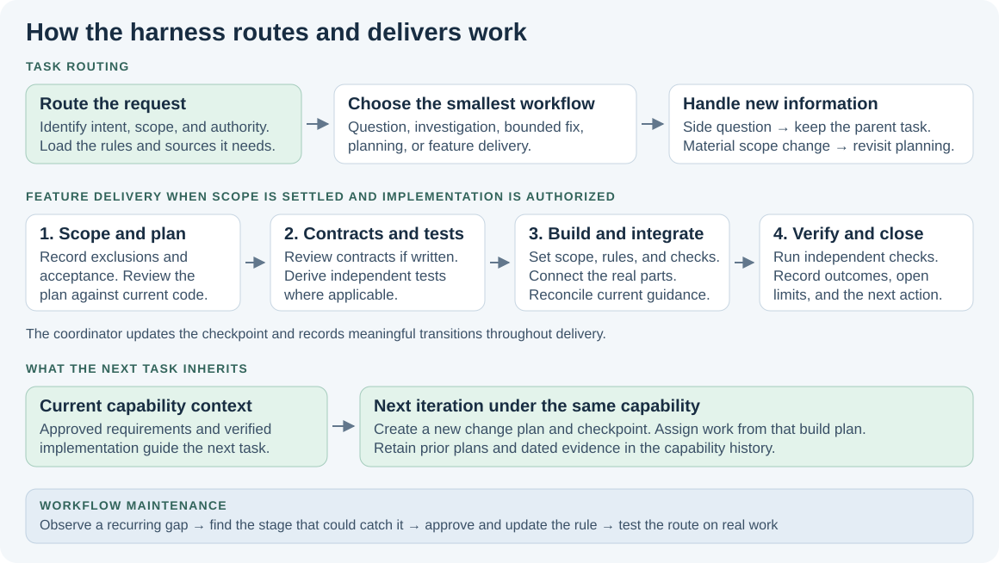

# Why I built a harness for coding agents

Have you had this happen? You build a feature, use it for a while, and realize you’d do part of it differently today. You ask an agent to make the next version. It gets the new behavior working, but it builds around the very design you wanted to fix. Now you have the enhancement and one more reason the old design is hard to change.

Then you find an old guideline that explains why the agent kept doing it that way. You reversed the decision two iterations ago, but the guideline is still in the repo and still reads like an instruction. As the feature grows, the agent spends more time reading its history and you spend more time explaining which parts still apply.

I think a lot of this comes down to what the agent thinks you asked it to solve. Give it a method that takes two inputs, performs a specific calculation, and must return a nonzero status constant. That return value is part of what the agent will check before calling the method done. Give it a whole feature with the same requirement halfway down the spec, and it can get the feature working while returning zero on one branch. The words were there both times. What counted as finishing the task changed.

The same thing happens with rules like “reuse UI components” or “test responsiveness.” I want the UI assignment to name the shared component the agent should inspect and the screen sizes it needs to check. I want the method’s return value checked in a unit test as soon as the method exists. Finding either problem after the whole feature is integrated means someone has to reopen work they thought was finished.

That’s what I built the harness to do. It identifies the task the agent is actually working on and gives each call the sources, scope, rules, and checks that matter for that decision. The agent can then make routine implementation choices without asking me to repeat the whole project’s history or approve every detail.

Take a reporting page that needs CSV export. The first thing I’d want the agent to do is look at how the page already filters data and checks access. If some columns are sensitive, I need to decide who can export them. The agent can decide how to escape a comma. And if I ask halfway through whether we could email the report every week, I want an answer and then I want it back on the export. Scheduling becomes its own delivery when I decide to build it.

Once we agree on the export, the coordinator records what’s in scope and what counts as done. An architect checks where the change belongs in the existing code. If there’s a new written interface, it gets reviewed before the tester derives expectations from it. The coordinator assigns bounded pieces with an owner and checks for each. In this case, one of those checks is whether the export respects the same filters and access rules as the page.

When I come back for scheduled exports, I want the agent to start with how exports work today. The first delivery updates the current requirements and implementation reference. Its plan stays in the history so we can look up why we made a decision. The scheduled version gets a new plan and new assignments under the same reporting capability. If it reverses an earlier decision, we update the current guidance that would otherwise send the next agent back to the old one.

Sometimes the workflow itself needs the fix. If we keep catching an access problem in final review, I’d ask where we first had enough information to catch it. If that was when we wrote the contract, that’s where the check belongs. Record why it was added, try it on a real task, and see whether it catches the problem earlier. If it only repeats another check, remove it. I built the harness to spend less time steering the agent, and every extra step has to earn its place.

[How tasks, assignments, and workflow changes are recorded](workflow-and-task-lifecycle.md)
