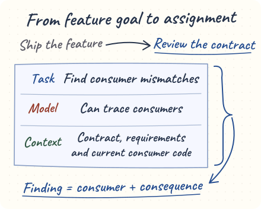
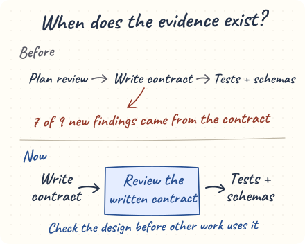

# The task has to fit the model

In one release, we reviewed the feature plan against the existing code and moved on to writing the interface contract. I asked for a second review once the contract existed. It found nine new problems. Seven came from the contract, which had been written after the first review. The implementing agents were building what the document said. We had given them a source they could follow, and following it carried the design problems into their work. [The decision record](../template/docs/decisions/DEC-005-design-review-gates.md)

That’s the part I skipped in my first article. I wrote about keeping agents in scope. The harder problem was deciding **what judgment to ask an agent to make, and when the evidence for that judgment would exist**.

## Task, model, context

An agent is a model with context and the ability to act toward a goal. It can read files, run commands, edit code, and use the results to take another step. When I decide what to give an agent, I think about three things.

- **Task.** What outcome am I asking for, and how can I tell if it got there?
- **Model.** Given the model I’m using, what kinds of work can it reliably do with the tools available to it?
- **Context.** What does it need to know or inspect to do this task correctly at this point in the work?

I treat the model as given when planning a delivery. I can choose the size of the task and assemble the context for it. A model can be good at tracing an interface through existing consumers and checking whether a proposed shape fits. “Build this feature” also asks it to settle scope, identify those consumers, design the interface, coordinate the implementation, and notice when any of its assumptions were wrong. It can write plausible code while getting one of those decisions wrong. A passing test written from the same mistaken contract can make the result look even better.

I split the work where I can name the decision, identify the sources that bear on it, and say what a useful result looks like. If a reviewer needs a contract that hasn’t been written yet, drafting the contract is a prerequisite. If the reviewer finds a product rule that nobody has decided, that decision goes to the owner. Once the contract is settled, separate implementers can work against it when their ownership is clear. Somebody still has to connect the pieces and exercise the whole feature.

## What changed when we added the second review?

The original plan review had a useful job. The Architect read the plan, current code, and tests to see where the feature belonged, what it could reuse, and what it depended on. That review could finish before there were any exact fields, error cases, or bounds to inspect.

Once the interface was written, there was a different task. The Architect could take the proposed fields and errors, trace them to the consumers that would have to handle them, and report where the design broke an expectation. The assignment could name the written contract, the reviewed plan, the approved requirements, and the relevant code. Each finding could point to a specific part of the design and explain what would break downstream.

The harness now puts that check before tests and schemas derive from the written contract. The Tester takes expected behavior from the approved requirements and reviewed design, then executes those expectations against the integrated feature. If the contract changes materially, the workflow reopens the affected review. A feature without a separate written contract skips that second gate. [Feature delivery](../template/docs/workflows/feature-delivery.md) · [Tester brief](../template/docs/agents/tester.md)

## What does the harness actually give each agent?

The coordinator uses the repository router to select a workflow for the task at hand. A bounded correction that preserves the contract can have one implementer and one qualified independent reviewer. A material feature change needs more decisions to be settled before people or agents can work in parallel. The workflow says which evidence has to exist before each assignment starts. A role says what that assignee reads, owns, and returns. I’d add a role when that responsibility keeps recurring and needs its own sources or checks. [Task router](../template/docs/README.md) · [Bounded change](../template/docs/workflows/bounded-change.md)

In the build plan, an assignment has an owner, owned paths, dependencies, and evidence or a blocker. The shared agent protocol adds the sources, allowed actions, acceptance checks, and expected handoff. Those details let the assignee inspect the repository directly and let the coordinator tell whether the result answers the question. Reviewers are chosen from what the change affects. A diff can leave the frontend untouched and still change what a user can do there. [Build plan template](../template/docs/templates/build-plan.md) · [Shared agent protocol](../template/docs/agents/common.md) · [Review workflow](../template/docs/workflows/review.md)

The context also has to stay usable next week. The capability’s requirements say what the product should do today. Its implementation reference says how the code works at a verified revision. The change record says what this delivery is doing and what evidence it has so far. A later iteration gets its own plan and updates the current capability documents when behavior changes. A fresh Claude Code or Codex session can find the open change through the work index, then check the checkpoint against Git and review state before taking its next action. [Documentation standard](../template/docs/standards/documentation.md#capabilities-changes-and-iterations) · [Session protocol](../template/docs/workflows/session.md#resume-and-handoff)

## How I investigate a miss

I start with the result and trace it back to the assignment. Was the task asking for several judgments with different prerequisites? Was an applicable source missing or stale? Did the agent have the relevant evidence and still fail to use it? Those cases call for different changes. I can split the task, repair the route to the current source, or give the same bounded task and evidence to another model and compare the results. A rerun is evidence about that assignment. One bad result alone tells me little about the model’s overall capability.

The contract review gave the Architect a specific judgment to make as soon as the written design was available. The repository records why that gate exists, and the maintenance workflow asks us to try such changes on real work. The harness makes the prerequisites and evidence explicit. The coding session is responsible for following them. [Changing the harness](../template/docs/workflows/knowledge-maintenance.md#changing-the-harness)

If you try this on your own repo, start with the last bug that got through a review. Find the earliest point where someone had enough evidence to catch it. Write down the exact judgment that person or agent could have made, what they would have needed to read, and what finding they should have returned. Then run that assignment on the next change that crosses the same boundary. [Adoption guide](../ADOPT.md)
