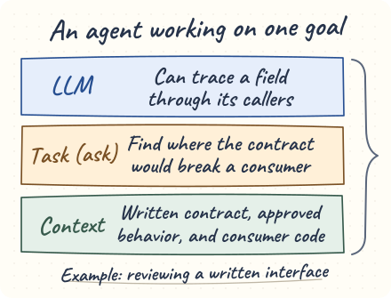
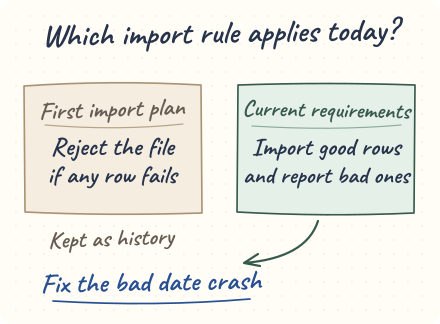
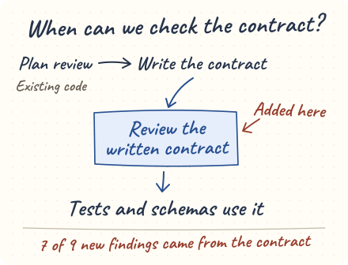

# The model is rarely the problem. The context is.

*A coding agent is a model, a task and a context. Models are now good enough for most software engineering work, so the engineering has moved to the other two: cutting work into tasks a model completes correctly, and giving each task exactly the instructions and data it needs. This article builds a repository harness from that idea, one problem at a time, using one small product as the running example.*

A coding agent will write a correct CSV parser in one turn. Ask the same agent to add scheduled imports to a product that already has imports, and something different happens. The feature works. But it aborts the whole file on the first bad row, because a guideline in the repository says imports are all-or-nothing. You reversed that decision two iterations ago. The guideline is still there, and it still reads like an instruction.

Did the model fail? It read what the repository gave it and followed it carefully. I would call that a context failure, and after building products with Claude Code and Codex working in the same repositories, I think most agent failures that reach a review are of this kind.

So before any tooling, we need a clear picture of what an agent is.

## What is an agent, exactly?

An **agent** is three things working together, plus hands.

- The **model** is the thinking part. Every model has a range of tasks it completes correctly. Inside that range it is dependable. Outside it, the output still looks confident, and it is wrong more often.
- The **task** is what you ask for in one turn, together with how you will know it is done.
- The **context** is everything the model has in front of it while it works: instructions, rules, the files it was pointed to.
- **Tools** are the hands. They let the model read files, run commands and edit code.



For most day-to-day software engineering, the model is capable enough. So where does it go wrong? In the pairing of the other two.

"Add scheduled imports" is not one task. It asks the model to settle scope, find every consumer of the existing import code, design an interface, write the code, test it, and notice when an early assumption was wrong. Several of those judgments are well inside its range. Bundled together, with nothing checked before the next step depends on it, they are not.

And the context for that bundle is "the whole repository, plus whatever guidance files exist". That is how the all-or-nothing rule got in.

This gives us three problems to solve, and the rest of the article takes them in turn:

1. **Scope.** Break the work into tasks that each sit well inside what the model does correctly.
2. **Assignment.** Give each task to an agent with the right responsibility.
3. **Context.** Give that one task the instructions and data it needs, and nothing else.

A **harness** is the part of the repository that answers these three the same way every time, so that you do not answer them by hand in every chat.

## The running example

We need something concrete to carry through. Take a small product that lets users import contacts from a CSV file. It has been through two iterations already:

- **Iteration 1, CSV import.** A user uploads a file. If any row is invalid, the whole file is rejected.
- **Iteration 2, partial imports.** The owner reverses that. Bad rows are skipped and reported, and good rows are imported.

Two requests are waiting:

- **A small fix.** A malformed date crashes the batch. It should be skipped like any other bad row.
- **A new feature.** Scheduled imports: fetch a file from a URL every night.

We will send both through the harness.

## First attempt: one file of instructions

The obvious place to start is a single instruction file at the root of the repository. Both tools read one, so you write your rules there.

```text
AGENTS.md                               (after six months)

- Use the shared Button component for all actions.
- Migrations must be reversible.
- An import is all-or-nothing: reject the file if any row fails.
- Dates are stored in UTC.
- Imports skip invalid rows and report them to the user.
- Check layouts at 375 and 1280 pixels.
- Billing webhooks must be idempotent.
...
```

Two problems are visible in those seven lines.

**The file contradicts itself.** Lines three and five are both about imports. One is from iteration 1 and one from iteration 2. Nobody deleted the old one, because nobody was sure what else depended on it. An agent cannot tell which is current. Neither can a new engineer.

**Every task reads everything.** The date fix touches one backend function. It gets the button rule, the migration rule, the layout rule and the billing rule. Each one is true. For this task each one is noise, and noise is not harmless. It is text the model weighs against the part that matters.

The usual response is to split the file by team: a frontend file, a backend file. That shrinks the noise a little and leaves the contradiction exactly where it was. The split is along the wrong line.

## Giving each kind of knowledge one home

Look again at the seven lines. They are different kinds of statement that happen to share a file. "Migrations must be reversible" is a technical rule that applies everywhere. "Imports skip invalid rows" is the approved behavior of one feature. "An import is all-or-nothing" is history. Each kind changes for a different reason, so each gets its own home.

| Kind | What it holds | Changes when |
| --- | --- | --- |
| **Requirements** | The approved behavior of one capability | The owner approves different behavior |
| **Standards** | Reusable technical rules, each with a stable ID | An approved rule changes |
| **Decisions** | Why a choice was made and who approved it | A choice is made or replaced |
| **References** | What the code does today, checked against source | The implementation changes |
| **Delivery records** | The plan, state and evidence of one effort | That effort moves forward |

A **capability** is a durable area of the product. Imports is one. Here is how it sits on disk after two iterations:

```text
docs/capabilities/imports/
  README.md            what imports is, and which page to read for which task
  requirements.md      "Invalid rows are skipped and reported."
  reference.md         where the code lives, who calls it, how to test it
  history.md           two rows, one per change, each linking its record
  changes/
    csv-import/        plan and evidence from iteration 1
    partial-imports/   plan and evidence from iteration 2
```

Where did "all-or-nothing" go? It is in `changes/csv-import/plan.md`, which is a dated record of what was decided then. It is not in `requirements.md`, because iteration 2 rewrote that page when it finished. This is the rule that fixes the pile-up:

> Current documents describe the product as it is now. Each change keeps its own dated record. The two are never the same file.



An agent starting a task reads the current pages. It opens an old plan only when it needs to know why something was decided. And the root `AGENTS.md` shrinks to a dozen lines that point to a router. It holds no rules of its own, so it has nothing to contradict. [Documentation standard](../template/docs/standards/documentation.md)

We have traded one problem for another, though. The knowledge is now spread over many small files. Something has to decide which of them a given task reads.

## How does a session decide what to do?

A chat is not a task. In one sitting you might ask how imports handle duplicates, request the date fix, and then start discussing scheduled imports. These need three different amounts of process. A question should get an answer and nothing more. The fix needs a light record and a check. The feature needs a plan.

So the main session **routes each task**: once when it starts, and again whenever its scope materially changes. There is no separate router agent. Before substantive work, the session writes five lines. Here they are for the date fix:

```text
Objective / scope: skip a row with a malformed date; do not fail the batch.
  Domain and capability: product / imports.
Selected workflow / stage: bounded change / scoped. Responsible: main session.
Required sources: imports requirements and reference; development standard.
  Authorized actions: edit the parser and its tests. No commit.
Owning checkpoint: docs/capabilities/imports/changes/malformed-date/record.md
Unresolved findings / next action: none / read the parser and its callers.
```

Read it line by line, because this is where two of our three problems get their first answer.

The first line is the **scope**. It is one outcome, stated so that someone can check it. The fourth line is the **context**: two capability pages and one standard. Compare that with the six-month `AGENTS.md`. The button rule, the layout rule and the billing rule are simply never loaded, because the task was routed to a capability and they belong to others.

The routing comes from two short tables. The **router** maps a domain or capability to its entry page. The **workflow index** maps an intent to a workflow:

| Intent | Workflow |
| --- | --- |
| Explain behavior or locate code | Question |
| Trace a problem or weigh alternatives | Investigation |
| Settle an unclear scope with the owner | Planning |
| Small correction that keeps approved behavior | Bounded change |
| New feature or material change | Feature delivery |
| Check finished work | Review |
| Keep the knowledge true | Knowledge maintenance |

A side question does not end the task underneath it. If you ask "could we email a report after each import?" in the middle of the date fix, you get an answer, and the session goes back to the fix. Emailing reports becomes its own task when you decide to build it. [Session protocol](../template/docs/workflows/session.md) · [Workflow index](../template/docs/workflows/README.md)

For the date fix, routing is nearly the whole story. It is one task, and the model can do it. Scheduled imports cannot be handled the same way.

## Workflows: cutting a feature into tasks

A **workflow** is the lifecycle of one kind of task. It states what triggers it, what must be read, its stages, who owns each stage, and what evidence allows the next stage to start.

The last part matters most. Here is the starter feature delivery workflow applied to scheduled imports:

| Stage | The task at this stage | What must exist first |
| --- | --- | --- |
| Scope | Record the outcome, exclusions and acceptance checks | The owner's decisions on behavior |
| Plan reviewed | Check the plan against the existing import code | A written plan |
| Contracts reviewed | Check the written interface: fields, errors, bounds | A written contract |
| Tests derived | Write expected behavior as tests | A reviewed design |
| Implementation | Build bounded parts, one owner each | Settled interfaces |
| Integrated | Connect the real parts and run them | Finished parts |
| Verified | Independent tests and reviews | An integrated change |
| Complete | Reconcile the documents and close | Verified work |

Each row is a task with one judgment in it. "Does this plan reuse the existing row validator, or duplicate it?" is a question a model answers well when it is given the plan and the validator. And each row names its prerequisite. That column is easy to skim past, so here is what happened when ours was wrong.

### A gate in the wrong place

Our feature delivery originally had one design review, of the plan. During one release I asked for an extra review after the interface contract had been written. It found nine new problems. Seven of them came from the contract, which did not exist when the plan was reviewed.

Look at what the implementing agents had done. They built exactly what the contract said. The contract was their context, the context was wrong, and they followed it faithfully. A better model would not have helped. The judgment "is this interface right for its consumers?" had been requested before there was an interface to judge.

We added a second gate at the point where the contract is on the page, and recorded the nine findings as the reason. The general rule we took from it:

> Put each check at the earliest stage where its evidence exists. A later review cannot replace it, because by then the mistake is built in.



When should you create a new workflow? Only when a kind of task has a lifecycle that no existing workflow can absorb. A copy correction and a small refactor share bounded change. A frontend copy and a backend copy of feature delivery would drift apart within weeks. [Feature delivery](../template/docs/workflows/feature-delivery.md)

The workflow has now cut the feature into tasks and put them in order. Each of them still has to be done by someone, and one session that plans, builds and then reviews its own work is not much of a check.

## Roles: who takes each task

A **role** is a recurring responsibility. It states what the role reads, what it owns, what it checks and what it hands back. The starter set has a domain expert, an architect, an implementer, a tester and three kinds of reviewer.

A role is not a persona. There is no "you are a senior engineer" in a brief. Here is the whole registration that makes the reviewer available in Claude Code:

```text
.claude/agents/reviewer.md

---
name: reviewer
description: Use for independent review of implementation quality and feature consistency.
tools: Read, Grep, Glob, Bash, Skill
---

Locate the repository root ... Read docs/agents/reviewer.md in full and follow
its required sources and the selected task workflow. Read docs/agents/common.md.
A missing required file is a visible blocker; do not proceed silently. ...
```

It carries a name, a tool list and one instruction: go and read the brief. The Codex registration is a `.toml` file with the same sentence in it. The brief itself lives once, in `docs/agents/reviewer.md`. This is what lets two tools work in one repository as one team. If you copy a role's instructions into each tool's own format, you get two roles that drift apart.

The registration is also where a model can be chosen. The kit does not pin one. If you want a stronger model for the contract review and a cheaper one for lookups, that is the place to set it.

### The assignment is the context

The **main session** coordinates. It routes the task, hands out bounded pieces, integrates the results and owns the record. When it hands the contract review for scheduled imports to the architect, the assignment looks like this:

```text
Outcome:      findings on the scheduled-imports contract, each tied to a consumer
Authorized:   read only
Workflow:     feature delivery / contracts reviewed
Sources:      changes/scheduled-imports/plan.md: the written contract design
                and the plan-review dispositions
              imports/requirements.md, imports/reference.md
              the row validator and the upload handler, which consume the result
Owned paths:  none
Checks:       every field and error has a consumer that handles it
Handoff:      findings with location, consequence and proposed correction
```

This is the third problem solved for one task. It is the context, built for a single judgment. Two details matter.

**It contains links, not summaries.** The architect opens the contract and the validator itself. A summary written by the coordinator loses the detail that matters, and an agent working from a summary builds what the summary said.

**It says what to return.** A finding tied to a consumer is something the coordinator can check. "Looks good" is not.

When do you create a role? When the same expertise or ownership keeps recurring, or the owner says it will. Never for one feature. Split a role only where ownership is truly separate, for example a frontend and a backend implementer with different standards. [Shared agent protocol](../template/docs/agents/common.md) · [Roles](../template/docs/agents/README.md)

## Where do skills fit?

Workflows and skills are easy to confuse, because both look like a list of steps.

- A **workflow** answers: what kind of task is this, who owns each stage, and what must be true before moving on?
- A **skill** answers: how do I carry out this one procedure, step by step?

Workflows call skills. A skill that only repeats a workflow's gates should not exist.

The kit ships two skills. The first, `maintain-knowledge`, is the procedure for putting a fact in its right home. Suppose the owner decides during scheduled imports that a fetch which fails three nights in a row pauses the schedule. The skill walks through it: search for an existing owner of that rule, classify it (approved behavior, so it goes to `requirements.md`), record the approval, check any claim about the code against the code, repair the links, and note which documents changed. [The skill](../template/.agents/skills/maintain-knowledge/SKILL.md)

The second, `change-harness`, is the procedure for changing the harness itself: adding, changing or retiring a workflow, role, gate or skill. It comes up again near the end of this article.

## Reviewers: chosen from the change

There is no fixed review panel. When the work is ready, the main session looks at the actual diff, the approved intent, and the consumers the change touches, including files that did not change. Then it selects coverage by impact.

| What the change affects | What must be checked |
| --- | --- |
| Product behavior | Consistency with the approved requirements |
| Implementation code | Code quality and affected consumers |
| Anything a user sees | The real journey, executed independently |
| Every delivery | That the documents now match what was built |
| A pull request | The whole diff against its base |

For our two requests this gives very different amounts of review:

- **The date fix** changes one function and keeps approved behavior. One independent reviewer checks the correction, the existing tests and the documents.
- **Scheduled imports** changes behavior, adds an interface and adds a settings screen. It gets the two early design reviews, a tester who wrote expectations before the code existed, a code reviewer, a documentation reviewer and a final assessment of the whole pull request.

Two rules hold at both sizes.

**Independence cannot be self-certified.** The author of a change is not its independent reviewer. A reviewer who fixes a finding cannot then certify that fix.

**A check that did not run is incomplete.** If a required review could not happen, the record says so. A person can accept the risk. That acceptance is recorded, and the check is still not relabelled as passed. [Review workflow](../template/docs/workflows/review.md)

## What happens when the session ends?

Scheduled imports will not be finished in one sitting. A chat's memory ends with the chat, so the state of the delivery lives on disk, in a **checkpoint** that is written before implementation starts:

```text
changes/scheduled-imports/build-plan.md

Objective:      nightly import from a URL, per approved plan
Workflow/stage: feature delivery / implementation
Branch:         feature/scheduled-imports
Status:         fetcher done; scheduler in progress; settings screen not started
Open findings:  C-3 (retry bound) fixed, awaiting architect recheck
Next action:    finish scheduler against the reviewed contract

Transitions
  2026-03-02 10:14  coordinator  scope -> plan reviewed      (2 findings closed)
  2026-03-03 16:40  coordinator  plan -> contracts reviewed  (C-1..C-4 raised)
  2026-03-04 09:05  coordinator  contracts -> implementation (C-3 open)
```

A fresh session, in either tool, finds this through a one-page work index. Then it does something that matters more than reading: it **verifies the checkpoint against the real branch and diff before acting**. A next-action line can be stale. Followed blindly, it repeats an operation that already happened. [Delivery records](../template/docs/standards/documentation.md#delivery-task-records)

## Closing a change, so the next one starts clean

We started this article with a stale rule. This is the stage that stops the next one from forming.

Before a delivery is called complete, every affected document gets one of three marks: **updated**, **verified unchanged** with a reason, or **outstanding** with an owner. An independent reviewer checks the list. For scheduled imports it would read something like this:

| Document | Disposition |
| --- | --- |
| `imports/requirements.md` | Updated: schedule, failure and pause behavior added |
| `imports/reference.md` | Updated: fetcher and scheduler added to the code map |
| `imports/history.md` | Updated: third row, linking this change |
| Development standard | Verified unchanged: no new reusable rule |
| Settings capability reference | Outstanding: new screen not yet listed (owner: coordinator) |

And the capability on disk gains one folder:

```text
docs/capabilities/imports/
  requirements.md      rewritten: now includes schedules
  reference.md         rewritten: now includes the fetcher and scheduler
  history.md           three rows
  changes/
    csv-import/
    partial-imports/
    scheduled-imports/   plan, build plan, evidence. Kept, never edited again.
```

When a fourth iteration starts next quarter, its agent reads two current pages and gets the product as it is. Nobody explains which parts of the history still apply. Routing gave the first task its context; closeout is what keeps that context correct for every task that follows. [Closeout gate](../template/docs/standards/documentation.md#closeout-gate)

## The harness changes the same way the product does

A harness that only grows becomes the pile it was built to prevent. So adding, changing or removing a workflow, role, gate, skill or standard is itself one procedure:

1. **Evidence.** A task that keeps recurring, work just finished that the owner wants to repeat, expertise that keeps recurring, a failure the process missed, or a step that no longer earns its cost.
2. **Check for extension.** Can something existing absorb it?
3. **Decision.** Record the reason and the approval.
4. **Write.** One canonical file.
5. **Connect.** Every index, route and registration that should lead to it.
6. **Prove.** Run one real task through it, in a new session of each tool, asked in the words people will use.

Every gate links the decision that added it. The contract review gate carries its nine findings. A project with no written contracts should delete that gate, and the harness says so.

The same procedure covers habits. Our planning workflow began as a convention in one agent's private memory: keep a scratch file while talking a feature through with the owner. It worked for that agent. Other agents could not follow it, and nothing stopped the agent from presenting its own details as the owner's decisions. It became a workflow only after that failure. A habit that lives only in memory is not part of the harness. [Changing the harness](../template/docs/workflows/knowledge-maintenance.md#changing-the-harness)

### Capturing what you just did

The most common evidence is work you have just finished. Say the first nightly import has run, and the owner checked it by hand: the file arrived, bad rows were reported, nothing was imported twice. They want that check every night, so they say it in plain words: "make this a workflow called nightly-import-check."

The `change-harness` skill takes it from there. It rebuilds the run from the chat, the diff and the change record, and separates what was particular to that night from the shape that repeats. It asks the owner three questions: how will you ask for this next time, what counts as done, and what must never happen without your go-ahead. Then it classifies the request. Checking existing behavior without repairing it is already the verification workflow, so this becomes a variant of verification with its own reading list, still called nightly-import-check, rather than a new workflow. The skill records the decision, writes the variant, connects the index and the router, and runs a check script over registrations, links and indexes.

The test uses the owner's own words. A new session in each tool is asked "check last night's import", without the variant's name, and has to pick it. When we tested the skill this way on a sample project, Codex chose it from its description alone. It also found that its own sandbox blocks writing a Codex registration without the owner's approval, and that limit is now one of the registration rules. [The skill](../template/.agents/skills/change-harness/SKILL.md)

## When to create what

| You notice | Create or change | Not this |
| --- | --- | --- |
| A new durable area of the product | A capability, with a README | A folder per feature request |
| The owner approves new behavior | A line in that capability's requirements | A rule in the entry file |
| A technical rule applies across features | A standard with a stable ID | A copy in every role brief |
| A choice needs its reasons kept | A decision | An edit to an old decision |
| A new effort starts on an existing capability | A new folder under `changes/` | Edits to the previous plan |
| A kind of task has its own lifecycle | A workflow | A per-team copy of an existing one |
| The same expertise keeps recurring | A role, with one brief and thin registrations | A role per feature |
| A multi-step procedure keeps being repeated | A skill | A skill that restates a workflow |
| A failure got past every check | A gate at the earliest stage with the evidence | A reminder at the end |
| You just finished something you will do again | Capture it with `change-harness`, which picks a clause, variant, gate, workflow, role or skill | A new workflow by default |

## How this relates to guides and sensors

The [harness engineering article](https://www.martinfowler.com/articles/harness-engineering.html) on martinfowler.com sorts an agent's controls two ways. **Guides** steer the agent before it acts, and **sensors** observe afterwards. Each can be **computational** (deterministic, like a test or a linter) or **inferential** (judged by a model, like an AI review).

In those terms, almost everything described here is inferential. The routing, the briefs and the assignments are guides. The reviewers and the closeout check are sensors. That is a deliberate choice. Every gate is an instruction that an agent follows and an independent reviewer checks, which is why the harness is plain Markdown and works in any repository and in both tools without extra wiring.

The two kinds of control fit together. A linter cannot tell an agent that the all-or-nothing rule was reversed. A router cannot stop a commit that breaks a type. This harness covers what a deterministic check cannot express: which knowledge is current, which task this is, and who should check it. Your tests, types and CI cover the rest.

## Finally

Go back to the three parts. The model was never the thing we changed. Everything in this article works on the other two:

- **Workflows** cut work into tasks and place each one where its evidence exists.
- **Roles** give each task to a responsibility that knows what to read and what to return.
- **Knowledge homes, routing and assignments** build the context for one task.
- **Closeout** keeps that context true for the next task.

Every piece answers one of the three problems we started with: scope, assignment, context. The harness is those answers written into the repository once, so that each new chat starts from them. [Adoption guide](../ADOPT.md) · [Principles](../PRINCIPLES.md)
