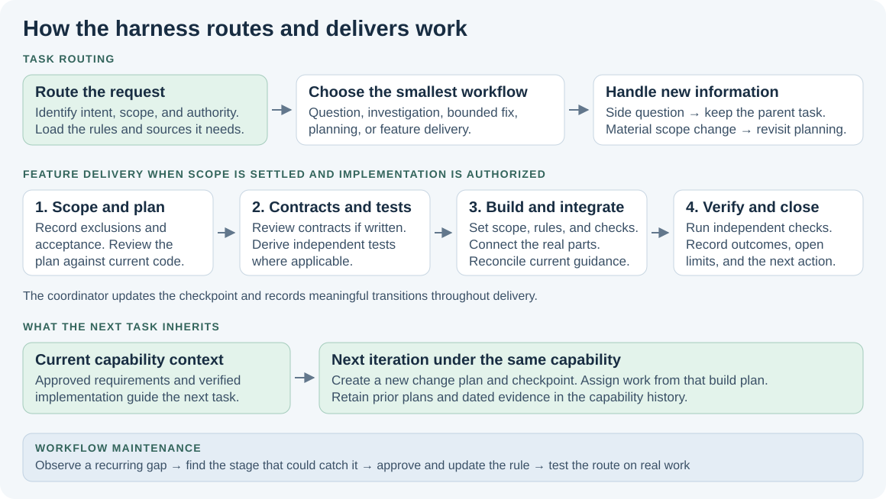

# Workflow and task lifecycle

A **task** has an objective, a domain, a selected workflow, a responsible agent, required sources, authorized actions, and a current stage. The main session routes each task when it begins and whenever its intent or scope materially changes. A short question or investigation can stay in the session. A task that changes the repository is a **delivery** and gets a checkpoint before implementation.

A **workflow** is the reusable lifecycle for a type of task. It defines its trigger, required context, stages and owners, evidence required to advance, failure handling, and how to resume. The coordinator selects an existing workflow for each task. Create a workflow only when a recurring kind of work needs distinct routing, ownership, or gates that an existing workflow cannot absorb. For example, a copy correction and a small refactor can share the bounded change workflow.



## Context for each agent call

The selected workflow and stage determine the context needed for the next call. The coordinator gives the agent a concrete outcome, links to the current sources and applicable rules, the scope it can act within, and the evidence expected back. The agent reads those sources directly. For a UI assignment, a reuse rule can become an instruction to inspect the named shared component before introducing another. A responsiveness rule can become a check at named viewport sizes.

Put verifiable requirements into the earliest check that can exercise them. A method’s return invariant belongs in a unit test before integration. A layout requirement belongs in a browser check as soon as the relevant UI is runnable. The assignment makes the requirement explicit. The check shows whether the work meets it and gives the coordinator evidence for advancing the stage.

## Feature delivery stages

This is the starter workflow for a new feature or a material change to behavior, interfaces, or architecture. If scope is unsettled, planning comes first. The product owner settles behavior, cost, privacy, and other scope choices. The coordinator records proposed implementation defaults, moves settled material into its owning documents when planning closes, and deletes the temporary notes. Implementation starts with its own authorization.

| Stage | Owner and evidence |
| --- | --- |
| Scope | The coordinator records the outcome, exclusions, acceptance checks, applicable rules, and authorized work. |
| Plan reviewed | The architect checks the plan against current code and tests. The coordinator records and resolves blocking findings. |
| Contracts reviewed | Where a written interface contract exists, the architect reviews the actual shapes, errors, and guarantees before tests or schemas derive from it. |
| Tests derived | Where the behavior can be tested at an executable boundary, an independent tester derives expectations from the reviewed design. |
| Implementation | Implementers deliver bounded assignments with named paths and dependencies. Parallel work begins once shared interfaces are settled. |
| Integrated | A named integration owner connects the real parts and runs the agreed developer checks. |
| Ready for review | The coordinator reconciles affected documentation, records the checkpoint, and selects reviewers from the actual diff and affected consumers. |
| Verified | Independent testers and reviewers report evidence and findings. The assigned reviewer rechecks fixes in the affected scope. |
| Complete | The coordinator records delivered behavior, verification limits, and the next action. Pull request readiness covers the whole diff. Deployment has its own evidence. |

A material change in scope or contract sends the affected work back through planning or review. The rest can continue within its existing authorization. A side question keeps the parent delivery and its next action in place.

## Ownership and later iterations

The coordinator updates the task’s checkpoint and appends meaningful transitions. It records the stage, branch and base, evidence, open findings, and next action. Specialists report results and findings for their assignments. The product owner approves product decisions, and reviewers own their independent findings and rechecks.

For the fictional reporting example, both deliveries live under one capability:

```text
docs/capabilities/reporting/
  README.md                       current entry point and reading routes
  requirements.md                 approved behavior
  reference.md                    verified implementation
  history.md                      links to dated change records
  changes/
    csv-export/
      plan.md                     first delivery scope and acceptance
      build-plan.md               checkpoint and assignments
      evidence.md                 dated checks and review results
    scheduled-exports/
      plan.md                     second delivery scope and acceptance
      build-plan.md               its own checkpoint and assignments
      evidence.md                 its own checks and review results
```

The coordinator routes the second iteration from the current capability documents and code, then adds assignments to the **new** build plan. Each assignment specifies an outcome, source links, authorized edits, owned paths, dependencies, acceptance checks, and the expected handoff. The work index links to unfinished deliveries. At closeout, the coordinator reconciles the current capability documents, adds the iteration to history, and removes its active work link.

## How the harness improves itself

Self-healing is an evidence-driven maintenance loop. When guidance conflicts with the implementation, reconcile the affected documents and have an independent reviewer verify the result. When a recurring failure exposes a gap in the process, identify the earliest stage that could have caught it. Extend the existing workflow if it fits, record the evidence and approval, update the canonical rule and its routes, and run a bounded task through it in each supported tool. Use the same process to retire a gate. The [change-harness](../template/.agents/skills/change-harness/SKILL.md) skill carries this out, and also turns work you just finished into a named workflow, role or skill. The loop is performed by agents and owners following the workflow, with deterministic checks enforced separately where implemented.

[Workflow selection](../template/docs/workflows/README.md) · [Feature delivery](../template/docs/workflows/feature-delivery.md) · [Record and closeout rules](../template/docs/standards/documentation.md) · [Knowledge maintenance](../template/docs/workflows/knowledge-maintenance.md)
